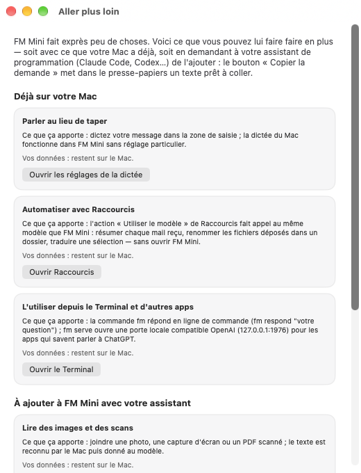

# FM Mini

*English summary — the rest of this README is in French.* FM Mini is a tiny macOS app: one white window, Apple's on-device language model (macOS 27, Apple Silicon), one attached document. Free, no account, nothing leaves your Mac. It summarizes, proofreads, rewrites, translates (15 languages) and extracts facts from the text you give it; it knows nothing about current events and very little by heart. Build without Xcode: `git clone https://github.com/acromega/fm-mini.git ~/fm-mini && cd ~/fm-mini && ./make-app.sh`. Customize by editing `Sources/FMMini/Personnalisation.swift`, or hand the repo to your coding agent (see POUR-LES-ASSISTANTS.md). Audited twice before release (see audits/). MIT.


FM Mini est une petite application Mac : une fenêtre blanche, un modèle de langage, une pièce jointe (PJ). Elle utilise le modèle qu'Apple livre avec macOS 27 — gratuit, sans compte, et vos textes ne quittent jamais votre ordinateur.

Elle fait exprès peu de choses : résumer, corriger, traduire, extraire l'essentiel d'un document, en 15 langues. Elle ne connaît pas l'actualité et ne sait presque rien par cœur : on lui donne le texte sur lequel travailler.

Pour qui : toute personne qui a un Mac Apple Silicon sous macOS 27 et veut essayer le modèle d'Apple sans rien installer d'autre que les outils en ligne de commande. Pas besoin de Xcode, pas besoin de savoir programmer.

Pour la modifier : ouvrez Sources/FMMini/Personnalisation.swift dans TextEdit, ou demandez à votre assistant de programmation (Claude Code, Codex…) — la fenêtre « Aller plus loin » de l'app contient des demandes prêtes à coller, et POUR-LES-ASSISTANTS.md lui explique les règles du dépôt.

Crédits : acromega + Claude, 2026. Licence MIT. Les audits sont dans audits/.


## Prérequis

- un Mac Apple Silicon ;
- macOS 27 ou ultérieur ;
- Apple Intelligence activée (Réglages Système → Apple Intelligence et Siri). La première activation télécharge le modèle : comptez quelques minutes, une seule fois. Ensuite, FM Mini fonctionne sans connexion ;
- les Command Line Tools Apple (installez-les avec `xcode-select --install` si nécessaire). Xcode n'est pas requis.

## Installation et démarrage

Téléchargez d'abord le dossier, de l'une des deux façons suivantes.

- Sans git : bouton **Code → Download ZIP** sur la page GitHub. Le dossier décompressé s'appelle `fm-mini-main` : déplacez-le dans votre dossier personnel et renommez-le `fm-mini` (sans espace).
- Avec git : `git clone https://github.com/acromega/fm-mini.git ~/fm-mini`.

Dans les deux cas, vous devez obtenir un dossier `~/fm-mini`, c'est-à-dire `fm-mini` directement dans votre dossier personnel. Les commandes ci-dessous supposent le dossier à cet endroit exact.

Ouvrez ensuite l'app Terminal : elle est dans Applications → Utilitaires (ou tapez Terminal dans Spotlight). Puis :

1. Tapez `cd ~/fm-mini` et validez par Entrée.
2. Tapez `./make-app.sh` et validez. Le script vérifie d'abord que le modèle Apple est disponible, puis construit l'application dans `build/`.
3. Tapez `open "build/FM Mini.app"` et validez.

Si le modèle n'est pas disponible, `make-app.sh` s'arrête avec un message et ne construit rien. Dans ce cas, activez Apple Intelligence dans Réglages Système, attendez la fin du téléchargement du modèle, puis relancez `./make-app.sh`.

La fenêtre s'ouvre pour la première fois au centre de l'écran en format vertical (460 × 760), peut être réduite jusqu'à 400 × 560, et mémorise ensuite sa taille et sa position.

## Installation en une ligne (si vous avez déjà utilisé le Terminal)

```
git clone https://github.com/acromega/fm-mini.git ~/fm-mini && cd ~/fm-mini && ./make-app.sh && open "build/FM Mini.app"
```

Sur un Mac neuf, macOS proposera d'abord d'installer les outils en ligne de commande : acceptez, attendez, recollez la ligne. Pour mettre à jour plus tard : `cd ~/fm-mini && git pull && ./make-app.sh && open "build/FM Mini.app"`

## Installation par un assistant (Claude Code, Codex…)

Lancez votre assistant depuis l'app Terminal — sinon le modèle lui est invisible (erreur 1008) — et collez-lui ceci :

```
Installe FM Mini, une petite application Mac open source (https://github.com/acromega/fm-mini) qui ouvre une fenêtre de chat sur le modèle de langage intégré à macOS 27. Fais exactement ceci, sans modifier le projet :
1. Vérifie que le Mac est Apple Silicon (uname -m = arm64) et sous macOS 27 ou plus (sw_vers). Sinon, dis-le et arrête-toi.
2. git clone https://github.com/acromega/fm-mini.git ~/fm-mini (si le dossier existe déjà, fais git pull dedans).
3. cd ~/fm-mini && ./make-app.sh. Si le script réclame les Command Line Tools, lance xcode-select --install, attends la fin de l'installation, puis relance ./make-app.sh. Si le script dit que le modèle n'est pas disponible, explique-moi comment activer Apple Intelligence dans Réglages Système et arrête-toi. Si tu obtiens l'erreur 1008 « not available in this context », c'est que tu n'as pas été lancé depuis l'app Terminal : dis-le-moi et arrête-toi.
4. Ouvre l'application avec la commande open affichée par le script, et dis-moi en trois lignes ce que je peux en faire (lis README.md).
```

## Utiliser FM Mini

Vous pouvez ajouter une PJ `.txt`, `.md`, `.csv`, `.json`, `.log`, `.rtf`, `.docx` ou `.pdf` contenant du texte, avec le bouton **Ajouter une PJ…** ou le menu **Fichier**. Les PDF issus d'un scan sans texte ne peuvent pas être lus. À l'accueil, les cinq puces ouvrent le sélecteur si aucune PJ n'est chargée ; après acceptation, elles placent leur demande dans le champ sans l'envoyer. Appuyez sur Entrée pour envoyer ; Maj-Entrée ajoute une ligne. Le temps de réponse est affiché sous chaque réponse du modèle.

- « Résume la PJ en 200 mots environ. »
- « Corrige l'orthographe et la grammaire de la PJ, en gardant le sens. »
- « Crée un quiz de cinq questions à partir de la PJ, avec les réponses. »
- « Extrais les noms, dates et chiffres de la PJ. »
- « Traduire la PJ en… »

Une PJ n'est envoyée qu'avec la première question : le badge « PJ : <nom> (N jetons) » confirme ensuite qu'elle reste dans la conversation. La jauge sous l'en-tête indique l'occupation du contexte ; FM Mini compresse automatiquement les anciens échanges lorsqu'elle approche de la limite, sans retirer les bulles visibles. Les bulles peuvent être copiées par survol ou clic droit.

## Menus et clavier

Le menu **Fichier** propose **Nouvelle conversation** (⌘N), **Ajouter une PJ…** (⌘O) et **Fermer** (⌘W). Le menu **Édition** propose aussi **Copier la dernière réponse** (⌘⇧C). Ces raccourcis fonctionnent même lorsque vous écrivez votre message.

Tab suit le réglage macOS Réglages Système → Clavier → Navigation au clavier ; toutes les actions ont un raccourci : ⌘N, ⌘O, Entrée, ⌘⇧C.

## Et si mon document est trop long ?

Le modèle ne peut lire qu'une quantité limitée de texte à la fois : ce n'est pas un bogue. FM Mini découpe alors automatiquement la PJ en parties, en respectant les titres, les paragraphes et les fins de phrase autant que possible. Choisissez une partie ; elle devient la PJ chargée pour la prochaine question, et vous pouvez revenir à une autre partie à tout moment. Si cette découpe ne correspond pas à votre besoin, copiez vous-même la section utile dans un petit fichier `.txt`.

## Limites

Un fichier ne peut pas dépasser 5 Mo. Le modèle a aussi une fenêtre de contexte limitée (selon le Mac, habituellement 4 096 ou 8 192 jetons) : l'application indique sous le bouton **Ajouter une PJ…** une estimation en mots (environ 2 600 ou 5 300 mots). Plus la conversation est longue, plus chaque réponse est lente ; FM Mini la compresse automatiquement. Lorsqu'une PJ dépasse cette fenêtre, FM Mini propose ses parties ; lorsque la conversation devient longue, elle conserve la PJ et résume automatiquement les anciens échanges. Il n'a pas de connaissance du monde en temps réel et les garde-fous d'Apple peuvent refuser certaines demandes.

## Langues

Les 24 langues prises en charge sont : fr, fr-CA, en ×4, es ×3, pt ×2, zh ×3, de, it, ja, ko, nl, da, nb, sv, tr, vi. Vers une langue hors liste, le modèle produit du texte mais sans aucune garantie (constaté : arabe très correct, thaï trompeur) ; seule la qualité du français a été mesurée.

## Ce qu'il ne sait pas faire

FM Mini ne sait pas compter, comparer, détecter une contradiction ou dire de façon fiable « le texte ne le dit pas » : il restitue, il ne vérifie pas.

## Personnaliser FM Mini

Vous pouvez adapter les textes, les couleurs, les crédits et la taille de la fenêtre dans [Sources/FMMini/Personnalisation.swift](Sources/FMMini/Personnalisation.swift), sans toucher au reste du dossier.

1. Dans le Finder, faites un clic droit sur `Sources/FMMini/Personnalisation.swift`, choisissez **Ouvrir avec**, puis **TextEdit**.
2. Modifiez seulement le texte entre guillemets (ou les deux nombres de `CGSize` pour la taille de la fenêtre), puis enregistrez.
3. Dans Terminal, après `cd ~/fm-mini`, relancez `./make-app.sh`.

Par exemple, vous pouvez changer une puce en remplaçant le texte de `puceResume`, tutoyer en remplaçant « vous » par « tu » dans `consigneModele`, ou agrandir la fenêtre en augmentant `width` et `height` de `tailleFenetreParDefaut`. Ne modifiez ni les noms des constantes, ni les commentaires, ni un autre fichier du dossier.

## Aller plus loin

Le menu **Aide → Aller plus loin…**, ou le lien au bas de l'accueil, ouvre une fenêtre de six cartes. Elle explique trois capacités déjà présentes sur le Mac (dictée, Raccourcis et Terminal), puis trois ajouts que vous pouvez demander à votre assistant de programmation : lecture d'images et de scans, pages web, ou dossier de documents. Les trois dernières cartes copient une demande prête à coller ; la fenêtre ne détecte rien, n'exécute rien et ne télécharge rien.



*La fenêtre « Aller plus loin » : trois capacités déjà sur le Mac, trois ajouts à demander à un assistant.*

Les demandes copiées renvoient à [POUR-LES-ASSISTANTS.md](POUR-LES-ASSISTANTS.md) et à [SPEC.md](SPEC.md), qui décrivent les règles de travail du projet.

## Dépannage

- Si l'application indique que le modèle n'est pas disponible, ouvrez Réglages Système, activez Apple Intelligence et attendez la fin du téléchargement.
- Ce cas ne se présente que si l'app a été copiée depuis un autre Mac. Une app construite sur votre Mac par `make-app.sh` s'ouvre directement. FM Mini est signé ad hoc : il est signé localement, sans certificat Apple de distribution. Gatekeeper peut d'abord afficher seulement **Placer dans la corbeille** et **Terminé**. Cliquez sur **Terminé**, puis ouvrez **Réglages Système → Confidentialité et sécurité** et choisissez **Ouvrir quand même** pour FM Mini.
- Si une partie sélectionnée ne répond pas à votre question, choisissez une autre partie dans la carte de la PJ ou joignez un extrait plus court.
- Un fichier de plusieurs Mo peut demander quelques dizaines de secondes à lire et à découper ; l'indication **Analyse du document…** reste visible pendant ce travail.
- Lors de la vérification, un script Swift isolé a pu afficher une erreur Apple `ModelManagerServices` alors que l'application signée fonctionnait. Dans ce cas, construisez et ouvrez l'application avec les trois commandes de la section « Installation et démarrage » plutôt que d'essayer le modèle depuis un script de shell.
- Si l'ancienne icône reste affichée après une reconstruction, c'est généralement le cache du Finder ou du Dock : exécutez `touch "build/FM Mini.app"`, puis rouvrez l'application. Si cela ne suffit pas, relancez le Finder ou le Dock.

## Vérification technique

Deux commandes lancent l'autotest, toutes deux depuis Terminal.app après `cd ~/fm-mini` :

- `swift run -c release FMMini --autotest` compile puis lance l'autotest sans passer par l'app construite ;
- `build/FM Mini.app/Contents/MacOS/FMMini --autotest` lance l'autotest de l'app déjà construite par `make-app.sh`.

L'autotest vérifie la réponse normale sans PJ, « salut », un résumé, les puces PJ (annulation et insertion sans envoi), la fenêtre de contexte, la lecture du DOCX et du PDF sans texte des fixtures, la limite de 5 Mo, le découpage d'une PJ de 20 000 mots et la compression d'une conversation.
